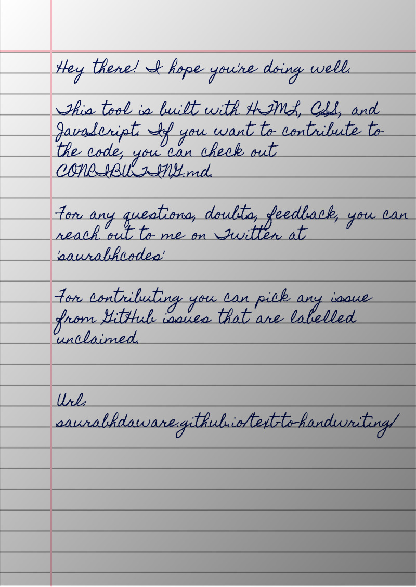

# Text to Handwriting AI

Turn typed text into realistic handwritten pages, or build a complete handwritten assignment, with a filled-in front page and AI-drafted answers.



Maintained by [CodewithWitcher](https://github.com/CodewithWitcher).

## Two modes

Use the switch at the top of the page.

### Classic

The original quick converter. Type or paste text, choose a font, ink and paper, then generate images or a PDF.

### Advanced (AI)

A guided, four-step flow:

1. **Template & handwriting.** Pick an assessment template (Q&A, short answers, detailed answers, essay, lab report, case study, or your own). Choose a font or upload your own `.ttf`, then set ink colours for answers and headings, heading style, ruled lines, margin, and natural variation (small per-word tilt so it doesn't look like a font). A live preview updates as you change things.
2. **Front page (optional).** Upload your university or college front page (image or PDF). *Auto-detect* uses OCR to find blanks such as "Name:", "Roll No.:" and "Subject:", then writes your details in your handwriting. *Smart detect (AI)* lets the AI decide which blank is which. Drag any value to fine-tune it, and save the layout to reuse next time.
3. **Questions & answers.** Choose one of three sources:
   - **Upload the question paper (PDF).** The AI lists every question with its marks. Scanned PDFs are read with OCR, or directly by Claude.
   - **Paste the questions.**
   - **Write or paste your own content.** No AI is needed. Use simple formatting for headings and lists.

   Then generate the answers one by one with AI. Answer length follows the marks and the template. You can edit, regenerate or reorder anything. **No API key?** Click *Copy prompt*, paste it into ChatGPT, Claude.ai or DeepSeek, paste the reply back, and click *Import answers*.
4. **Preview & download.** Text flows across A4 pages: words are never cut, and headings are never left alone at the bottom of a page. Edit the final text if you like, then download one PDF (front page first) or the individual page images.

**My Profile** stores your name, roll number, course, subject and other details in this browser. To fill it from a file, click *Download profile template*, fill in the JSON in any text editor, then *Import profile*. **AI Settings** supports Claude, DeepSeek, OpenAI, Google Gemini, OpenRouter, Groq, Ollama (local, no key) and any OpenAI-compatible endpoint.

## Run locally

Requires Python 3.8+ (no other dependencies).

```bash
python3 server.py            # http://127.0.0.1:8080
python3 server.py --port 8090
```

The server serves the app and relays AI requests to the provider you choose, so browsers don't block them (CORS). Classic mode also works from any static file server.

> macOS: port 5000 is taken by AirPlay Receiver, which is why the default is 8080.

## Privacy

- Everything you enter (profile, templates, fonts, front pages, drafts, API keys) is stored only in this browser (localStorage and IndexedDB).
- API keys are sent only to the provider you select. When the local server relays a request, it doesn't store or log keys or content.
- Only academic context (course, subject, semester) is included in AI prompts. Your name and ID numbers are never sent.
- *My Profile → Delete all saved data* wipes everything. Data exports never include API keys.

## Content formatting

Own content and the final text step use this formatting:

| Write | Result |
| --- | --- |
| `# Title` | Centered title |
| `## Heading` | Question / section heading |
| `### Sub-heading` | Sub-heading |
| `- item` / `1. item` | Bullet / numbered list |
| `**text**` | Underlined emphasis |
| blank line | New paragraph |
| `---` | New page |

## Project structure

```
index.html              Page shell: Classic markup + Advanced markup
server.py               Local server + AI request relay (stdlib only)
js/app.mjs              Classic mode (original behaviour)
js/mode-switch.mjs      Classic / Advanced switch (lazy-loads Advanced)
js/config.mjs           Repository / author links
js/advanced/
  main.mjs              Advanced mode controller (tabs, steps)
  llm.mjs               AI providers (Claude SDK + OpenAI-compatible)
  questions.mjs         Question extraction (AI and rule-based)
  templates.mjs         Templates, prompts, document composition
  renderer.mjs          Pagination + handwriting page rendering
  frontpage.mjs         Front page detection / editor
  pdf-input.mjs         PDF text extraction + OCR
  profile.mjs, store.mjs, output.mjs, ui.mjs, loaders.mjs
css/advanced.css        Advanced mode styles
```

## Libraries

- [html2canvas](https://github.com/niklasvh/html2canvas): renders pages to images
- [jsPDF](https://github.com/parallax/jsPDF): builds the PDF
- [pdf.js](https://github.com/mozilla/pdf.js): reads uploaded PDFs
- [Tesseract.js](https://github.com/naptha/tesseract.js): OCR for front pages and scanned papers
- [Anthropic TypeScript SDK](https://github.com/anthropics/anthropic-sdk-typescript): Claude integration
- [Cypress](https://github.com/cypress-io/cypress): end-to-end tests (`npm test`, with the server running)

## Responsible use

Use this for notes, practice, accessibility (for example, if handwriting is hard for you) and mock-ups. Check your institution's rules before submitting AI-assisted or generated work.

## License

MIT. See [LICENSE](LICENSE). Based on the MIT-licensed text-to-handwriting project.
